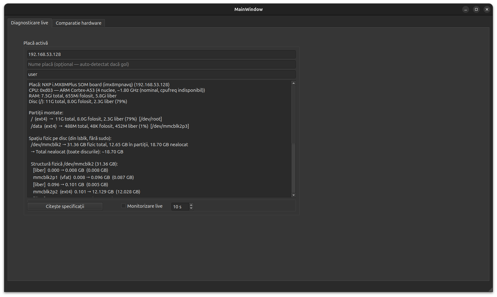
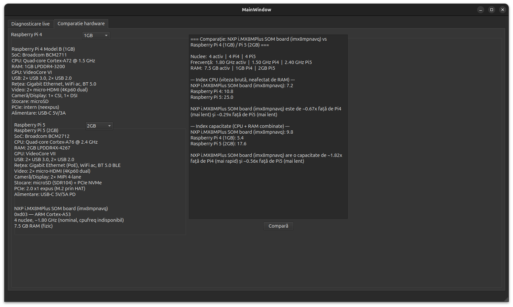

# NavQPlus Dashboard

Aplicație desktop Qt (C++/CMake) pentru diagnosticarea live și compararea hardware a plăcilor embedded din familia **NXP i.MX 8M Plus** (NavQPlus, FRDM-IMX8MPLUS) — dezvoltată pentru monitorizarea și evaluarea plăcilor folosite în proiectele de robotică ale Arkon Robotics.

---

## Cuprins

- [Prezentare generală](#prezentare-generală)
- [Funcționalități](#funcționalități)
- [Capturi de ecran](#capturi-de-ecran)
- [Cerințe preliminare](#cerințe-preliminare)
- [Instalare și build](#instalare-și-build)
- [Configurare acces SSH](#configurare-acces-ssh)
- [Ghid de utilizare](#ghid-de-utilizare)
- [Detalii tehnice](#detalii-tehnice)
- [Limitări cunoscute](#limitări-cunoscute)
- [Direcții viitoare de dezvoltare](#direcții-viitoare-de-dezvoltare)
- [Structura proiectului](#structura-proiectului)
- [Licență](#licență)

---

## Prezentare generală

**NavQPlus Dashboard** e un instrument de diagnosticare și comparație hardware, construit pentru a răspunde unei nevoi punctuale: verificarea rapidă a stării, specificațiilor și funcționalității ROS2 pe plăci de dezvoltare bazate pe SoC-ul **NXP i.MX 8M Plus** (NavQPlus și FRDM-IMX8MPLUS), fără a fi nevoie de conectare manuală repetată prin SSH sau consolă serială.

Aplicația se conectează la o placă activă prin SSH, citește un set de informații de sistem (hardware, partiții, spațiu de stocare, stare ROS2), le afișează structurat, și le compară cu specificațiile oficiale ale plăcilor Raspberry Pi 4 și Raspberry Pi 5, ca punct de referință.

---

## Funcționalități

### Tab 1 — Diagnosticare live

- **Detectare automată a plăcii** — citește `hostname` și modelul din `/proc/device-tree/model`, fără a fi nevoie de introducere manuală a numelui plăcii
- **Specificații hardware**: model CPU, număr de nuclee, frecvență (curentă sau nominală, cu fallback dacă `cpufreq` nu e disponibil pe kernel), RAM total/folosit/liber, informații despre disc
- **Listă completă de partiții montate**, cu tip de sistem de fișiere, dimensiune, spațiu folosit/liber
- **Calcul spațiu fizic nealocat**, per disc, fără a necesita privilegii `sudo` — folosește exclusiv `lsblk` și `/sys/class/block/*/start`+`size`
- **Structură fizică ordonată a discului** — layout exact al partițiilor și golurilor dintre ele, echivalent cu `parted print free`, dar fără dependență de `sudo`
- **Verificare ROS2 live**, independentă de distribuție (Humble, Jazzy, sau orice altă versiune instalată în `/opt/ros/`) — listează nodurile și topicurile active în momentul citirii
- **Auto-refresh configurabil** — re-citire periodică automată a specificațiilor, cu interval ajustabil (5–300 secunde), protejată împotriva suprapunerii cererilor
- **Istoric persistent** — fiecare citire se salvează automat în fișiere CSV locale (`board_specs_log.csv`, `partitions_log.csv`), pentru analiză ulterioară sau comparații în timp

### Tab 2 — Comparație hardware

- Specificații oficiale complete pentru **Raspberry Pi 4** și **Raspberry Pi 5**, cu variantă de RAM selectabilă (1/2/4/8GB pentru Pi 4; 2/4/8/16GB pentru Pi 5)
- **Index CPU** — estimare relativă de performanță brută (nuclee × frecvență × factor generic de arhitectură), neafectată de RAM
- **Index de capacitate** — CPU-ul ajustat cu un factor de RAM (radical, cu randament descrescător), reflectând capacitatea reală de a rula workload-uri mai mari
- Comparație directă, exprimată explicit ca „mai rapid” / „mai lent” / „comparabil”, față de fiecare placă Raspberry Pi

---

## Capturi de ecran




---

## Cerințe preliminare

- **Sistem de operare**: Ubuntu (sau altă distribuție Linux) pe mașina de dezvoltare
- **Qt 6.11+** (module: Desktop, Widgets, Charts opțional — nu e folosit momentan)
- **Qt Creator**, cu kit configurat pentru **CMake** + compilator GCC 64-bit
- **Client SSH** funcțional (`openssh-client`)
- **Acces de rețea** la placa țintă (Ethernet, Wi-Fi, sau USB gadget networking, în funcție de placă)
- Cheie SSH configurată fără parolă către placa țintă (recomandat, obligatoriu pentru auto-refresh — vezi [Configurare acces SSH](#configurare-acces-ssh))

---

## Instalare și build

```bash
git clone <URL_REPO>
cd NavQPlusDashboard/NavQPlusDashboard
```

### Din Qt Creator

1. `File → Open File or Project` → selectezi `CMakeLists.txt`
2. Confirmi kit-ul `Desktop Qt 6.11.x GCC 64bit`
3. `Ctrl+R` (Run) pentru build + rulare

### Din linia de comandă

```bash
mkdir build && cd build
cmake ..
cmake --build .
./NavQPlusDashboard
```

---

## Configurare acces SSH

Aplicația necesită autentificare SSH **fără parolă** (cheie publică) către placa țintă, pentru ca citirea automată (și în special auto-refresh-ul) să funcționeze fără blocaje.

```bash
# Generezi o cheie, daca nu ai deja una
ssh-keygen -t ed25519

# Copiezi cheia publica pe placa
ssh-copy-id <user>@<IP_PLACA>

# Test
ssh <user>@<IP_PLACA> echo test
```

Dacă răspunsul e `test`, fără solicitare de parolă, configurarea e completă.

> **Notă**: userul implicit variază în funcție de placă — `root` pe unele imagini (ex. FRDM cu imagine custom), `user` pe altele (NavQPlus, imagine NXP standard). Aplicația permite specificarea userului direct din interfață.

---

## Ghid de utilizare

1. **Tab „Diagnosticare live”**:
   - Completezi IP-ul plăcii în câmpul dedicat (precompletat cu prefixul de rețea uzual)
   - Completezi userul SSH (opțional — implicit `root` dacă lași gol)
   - Numele plăcii se detectează automat; poți suprascrie manual dacă preferi o etichetă proprie
   - Apeși **„Citește specificații”** pentru o citire punctuală, sau bifezi **„Monitorizare live”** pentru citire automată repetată
2. **Tab „Comparație hardware”**:
   - Alegi varianta de RAM pentru Pi 4 și Pi 5 din listele derulante
   - Apeși **„Compară”** — necesită o citire validă din tab-ul 1 în prealabil

---

## Detalii tehnice

### Mecanism de citire date

Toate informațiile sunt colectate printr-o **singură conexiune SSH** per citire, executând un script shell compus care combină mai multe comenzi, separate prin marcaje unice (`###CHEIE###`), pentru a permite parsarea structurată a output-ului combinat într-un singur apel — reducând semnificativ latența față de conexiuni SSH separate per informație.

### Calculul spațiului nealocat (fără `sudo`)

Spre deosebire de abordarea clasică (`parted print free`, care necesită privilegii de root), aplicația calculează spațiul nealocat prin:
1. Citirea dimensiunii fizice a discului și a fiecărei partiții via `lsblk -nlbo NAME,SIZE,TYPE,PKNAME,FSTYPE` (flag `-l` esențial — dezactivează afișarea de tip arbore, care altfel prefixează numele partițiilor cu caractere grafice și rupe potrivirea exactă a numelor)
2. Citirea poziției exacte (sector de start) a fiecărei partiții din `/sys/class/block/<partiție>/start` și `/sys/class/block/<partiție>/size` (ambele accesibile fără privilegii speciale)
3. Calcul aritmetic al golurilor dintre partiții și față de capătul discului

### Verificare ROS2 independentă de versiune

Distribuția ROS2 instalată e detectată dinamic (`ls /opt/ros/`), fără nicio versiune hardcodată. Scriptul de mediu corespunzător (`setup.bash`) e sursat direct în sesiunea SSH, iar `ros2 node list` / `ros2 topic list` rulează cu timeout de siguranță (4 secunde), pentru a evita blocarea aplicației dacă daemon-ul ROS2 nu răspunde.

### Persistență date

- `board_specs_log.csv` — istoric al tuturor citirilor de specificații, cu timestamp
- `partitions_log.csv` — istoric al partițiilor citite, per placă și moment

Ambele fișiere se salvează în directorul standard de date al aplicației (`~/.local/share/NavQPlusDashboard/` pe Linux).

---

## Limitări cunoscute

- **Frecvența CPU** nu e disponibilă pe toate imaginile (unele kernel-uri nu expun `cpufreq`) — aplicația folosește un fallback la frecvența nominală cunoscută a CPU-ului, marcat explicit ca atare
- **Auto-refresh** necesită autentificare SSH fără parolă; dacă doar parola e disponibilă, funcționalitatea rămâne utilizabilă doar prin citire manuală
- **Indexul de performanță** din tab-ul de comparație e o estimare orientativă (nuclee × frecvență × factor generic de arhitectură), nu rezultatul unui benchmark real
- Testat momentan doar pe plăci **NXP i.MX 8M Plus** (NavQPlus, FRDM-IMX8MPLUS) — compatibilitatea cu alte arhitecturi ARM nu e verificată

---

## Direcții viitoare de dezvoltare

- [ ] **Verificare cameră** — test funcțional al interfețelor MIPI-CSI (listare device-uri video, captură de test) direct din aplicație
- [ ] **Export raport** — generare PDF sau CSV consolidat, cu toate datele curente (specs + comparație), pentru documentație sau prezentare
- [ ] **Comparație reală multi-placă** — extindere pentru a rula simultan pe ambele plăci NavQPlus disponibile, nu doar una activă la un moment dat
- [ ] **Grafice istorice** — vizualizare (via Qt Charts) a evoluției în timp a specificațiilor salvate în CSV (utilizare RAM/disc de-a lungul sesiunilor)
- [ ] **Autentificare SSH mai robustă** — suport pentru chei SSH multiple / agent SSH, nu doar cheia implicită a userului curent
- [ ] **Verificare hardware suplimentară** — GPIO, interfețe CAN, senzori conectați (IMU, LiDAR) prin ROS2 topics dedicate
- [ ] **Interfață vizuală îmbunătățită** — iconițe, temă vizuală consistentă, indicatori grafici (bare de progres pentru RAM/disc, nu doar text)
- [ ] **Suport pentru al treilea tip de placă** — extindere a comparației dincolo de Raspberry Pi 4/5 (ex. Jetson Orin Nano, alte SBC-uri relevante pentru robotică)

---

## Structura proiectului

```
NavQPlusDashboard/
├── CMakeLists.txt
├── main.cpp
├── mainwindow.h
├── mainwindow.cpp
├── mainwindow.ui
└── README.md
```

---

## Autor

Dezvoltat de **Gheorghiu Alexandru-Dan**, student FIIR (Facultatea de Inginerie Industrială și Robotică), Politehnica București.
